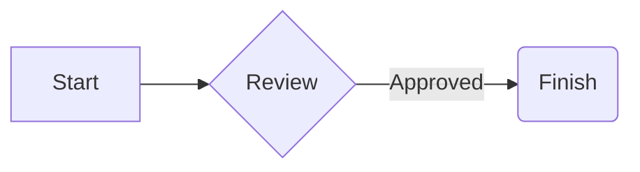

# tinyEnv desktop workbench

The optional workbench is a desktop workspace for `.chat.md` Markdown chats,
project files, a Bash terminal and bounded AI critique loops. It builds separately
from the Foundation example and its Rust provider. The native shell uses the
existing shared GUI boundary; Python's standard library implements the optional
AI and research helper. It needs no Docker service or browser server.

[COMPILE-workbench](../COMPILE-workbench) is the short build/run reference.
[Building](building.md) explains the maintained wrapper and native toolchain
requirements. The workbench keeps application behavior in its shared application
and models; GUI adapters provide generic controls and rendering.

## Build and start

From the repository root, with CMake 3.24+, Ninja, a C++20 compiler and Python
3.9+, build the FLTK host using the distribution's FLTK development package:

```sh
./build.sh workbench build release --backend fltk --build-dir build/workbench-fltk-release
./build/workbench-fltk-release/tinyenv-workbench-fltk --root /absolute/path/to/project
```

Launch without `--root` to use `~/tinyEnv/casual-chats`, a general-purpose chat
directory created on first use. An explicit `--root` selects an existing project
directory. The default appearance is dark, with muted blue, violet, amber and
green accents distinguishing flow blocks.

The framebuffer host uses the existing SDL2 display/input host and its native
prerequisites. Rev uses the existing prepared module toolchain described by
the [GUI guide](gui-boundary.md). Select a fresh build directory when changing
preset, backend or toolchain. Build commands use retained sources and acquire
no tools, models or network data.

`--sdk PATH` selects an existing verified native Linux C++ SDK without a Rust
extension. Use `release` for an optimized desktop build and `dev` for
debugging; `asan` adds instrumentation. The wrapper also supports
`--build-jobs`, `--test-jobs` and `build --configure-only`. Build trees record
the operation, backend, selected tools and inputs; changing those settings
requires a fresh tree. The optional component has no install/package operation
and does not join the default application's build or release graph.

The executable uses the selected Python interpreter and helper copied to the
build tree's `runtime/` directory. Keep that directory with the build output,
and rebuild after changing helper source. Python is a runtime requirement for
AI/research operations, even though its only libraries are from the standard
library. Pass `--chat relative/file.chat.md` to select an existing chat at launch.

Run the focused local workbench checks without a display:

```sh
./build.sh workbench test dev --headless --build-dir build/workbench-checks
```

These checks use deterministic local files and fake provider responses. They
must never contact an AI provider, search service, external endpoint or Kiwix
server. A local pass does not establish live provider or desktop qualification;
the [pending record](../.agent-pending/workbench-qualification.md) records those
limits and the next manual action.

The headless build also produces a read-only inspection tool:

```sh
./build/workbench-checks/tinyenv-workbench-tool inspect --root /absolute/path/to/project
./build/workbench-checks/tinyenv-workbench-tool parse --root /absolute/path/to/project --file loop.txt
```

`inspect` prints JSON describing discovered chats and root entries. `parse`
prints the canonical pseudocode, program and graph, or line/column diagnostics
on standard error. Both return status 1 on an error. Files must remain inside
the selected root; parent components and symlink traversal are rejected.

## Project and chat state

Chats are UTF-8 Markdown files with the `.chat.md` suffix (case-insensitive)
inside the selected project directory. Other `.md` and `.markdown` files are
ordinary documents, opened with the file editor rather than listed as chats.
Existing chat text can be renamed to this suffix explicitly; no Markdown files
are automatically converted. Opening a
chat selects its directory, terminal session, selector toggles and AI settings.
The chat file remains readable and editable using an ordinary text editor.
The companion state stores the current draft, pending-image metadata,
pseudocode, last submitted-message provenance, selected tabs, configured terminal
start directory, provider settings, source provenance and enabled Scribbles,
Refs and Tools paths. It also stores the per-chat Scribble builder mode, setup,
selected builder tab and retained task records. Image bytes are stored separately
in project-managed snapshots.
Credentials use the private provider-key controls or existing process environment
and private provider configuration, outside chat text and state.
Research sources persist bounded metadata, with raw source text omitted.
An explicit omission marker identifies provenance records that do not fit; long
live reports also show when display content is truncated.

| Data | Project-relative location |
| --- | --- |
| Chat text | A file ending in `.chat.md` |
| Chat state | `<chat-directory>/.tinyenv/<chat-filename>.state.json` |
| Attached image snapshots | `.tinyenv/images/` under the selected project root |
| Saved prompts | `.tinyenv/prompts.json` |
| Saved pseudocode snippets | `.tinyenv/pseudocode.json` |

Chat filenames exceeding 244 bytes use a SHA-256 filename in the companion
directory to stay within filesystem component limits. The JSON files use schema
version 1. Opening an explicit untouched workspace/chat creates no files;
the default casual-chat directory is created when needed. Per-chat state
changes, composer edits and history changes are autosaved after a 300 ms quiet
period, with pending changes flushed when switching or closing a chat. New chat
explicitly creates its file. A new chat refuses an existing destination or
orphan companion state. The terminal initially uses the chat's directory. Each chat has
independent state and its own owned terminal instance during the application
session; saved state restores its configured start directory, rather than a
running process. Typed Bash `cd` commands change the live shell but do not
update that saved start-directory setting.

The left pane provides Chats, Files, Filelight and Running Tasks. Files has
expandable directories, path navigation and contextual actions. Filelight shows
bounded disk-usage information. The center provides Chat Markdown, Pseudocode
Editor and Bash Terminal, with a split-chat view and composer. The right pane
provides Git, Sources, Selector, Pseudocode, Prompts and AI.

The global **Sidebar** checkbox in the bottom bar shows or hides the right pane
and remains reachable when that pane is hidden. It starts enabled and remembers
its setting across projects and restarts. Hiding the pane expands the center;
showing it restores the selected right tab, its fields and scroll position.
Send/Retry validation that needs AI settings reveals the sidebar and opens AI
at its repair controls; **Show AI settings** in Running Tasks does the same.
A preference-save error is reported without preventing that automatic reveal.

Right-click a file or folder, or use **Actions**, to open it, create a file or
folder, copy a text file, rename it, or delete it after confirmation. Deleting a
directory uses `rmdir` semantics: it must be empty, including hidden entries. There is no
recursive deletion. Destinations are never overwritten, symlinks are not
followed, and project roots/private application-state paths cannot be changed
through these actions. Rename/delete preserve open unsaved edits by refusing
the operation until those edits are saved or discarded; running tasks and
terminals may also need to finish or stop first. Bash Terminal provides a
**Stop** control.

Chat rename/delete also handles its companion state. These two-file operations
are not atomic: a failure reports any remaining paths; a failed state rename
attempts to restore the original chat filename. Renaming an older `.md` or
`.markdown` chat to `.chat.md` explicitly carries its valid old companion
state. Moving a folder preserves its contained state; a saved terminal start
directory that no longer exists falls back to the chat's current directory.
Other user-managed selector paths are not rewritten. Native file mutations
are currently implemented for qualified POSIX operations; unsupported
platforms report the operation as unavailable.

**Copy text file…** copies the saved bytes of an ordinary UTF-8 file, with no
NUL bytes and at most 8 MiB, to a new project-relative path. It rejects symlinks,
directories, an existing destination and missing destination parent directories.
Copying a `.chat.md` file requires the same suffix and also copies its valid
saved companion state when present. Pending changes in an open chat are flushed
first; ordinary unsaved file-editor content is not substituted. An existing
destination companion state is refused. Chat and state publication are separate
operations, so a late failure can leave the copied chat with unconfirmed state.
The diagnostic names those paths for inspection.

Escape dismisses the current dialog or menu and does not exit the application.
In the Scribble builder workspace, Escape neither leaves builder mode nor cancels
work; a nested file dialog or menu still handles its own Escape action.
Closing an edited file still requires saving or explicitly discarding changes.
Use the window's close control to exit.
Minimizing or switching away from the native window does not stop its tasks;
background redraws leave it minimized and do not reclaim keyboard focus.

Recursive chat and disk discovery skip common generated/private directories, including `.git`,
`.tinyenv`, `.ssh`, `.aws`, `.codex`, `.agents`, `.agent-work`, `build`,
`node_modules` and `.venv`, and exclude credential-like files. Discovery does not
recurse through symlinks. The default scan budget is 10,000 entries and the
maximum depth is 32; disk usage identifies truncated scans. Large projects
should use a narrower directory when the bounded disk listing is incomplete.
Chat discovery reports a limit error rather than returning an incomplete subset;
opening a known path remains possible. The immediate Files browser shows `.git`
while hiding credential-like names and companion-state directories.

Chat saves check the original bytes before publication so an external edit is
reported as a conflict. Chat text and companion state are independently saved;
failure after publishing text can leave state unsaved. The current draft is
retained so the user can inspect the error and recover. A conflict stops automatic
retries from overwriting the changed file. Do not assume saving several files is
one filesystem transaction. Ordinary files in the file editor retain manual
**Save** (also **F3**) and explicit discard on close.

For a retained chat autosave conflict, select that file in Files and open its
actions. **Copy retained chat and draft…** saves the in-memory history, draft
and companion state to a new `.chat.md` path without replacing the original or
switching the active chat. Ordinary **Copy text file…** is disabled for that
conflicted open chat. The conflict remains until **Discard retained changes…**
and its explicit **Discard and reload** confirmation reload the original text
and state from disk. Cancel its task and stop its terminal before discarding.
A failed reload preserves the retained buffer; a late two-file copy failure
reports the copied paths while the original retained changes remain available.

Prompt and pseudocode snippets are project-local data. Selecting or double-clicking
a snippet loads its editable preview. **Insert into message** explicitly inserts
that preview at the visible editor's caret/selection,
or appends it when the editor is absent. Flow insertion updates the current
composer's fenced pseudocode rather than chat history. The global **Tutorial**
checkbox starts off and is remembered across projects and restarts. Enabling it
shows the built-in pseudocode examples; disabling it hides those examples while
retaining custom snippets and saved snippet files. An example can be edited in
the preview before insertion or saved as a custom snippet.

Scribbles, Refs and Tools are editable path lists with independent enable toggles.
Their distinction is chosen by the user: Scribbles normally hold annotated
expertise, while Refs normally hold examples such as previous projects.

Selector chooses general web search, Wikipedia, Stack Overflow, selected local
text or an exported local Kiwix index, with query/result limits and an optional
Kiwix index path. New chats default to general web, eight queries and 24 results;
existing saved source choices and budgets are retained. Explicit larger
runs may select up to 1,000 queries and 3,000 results. Research stops when its
configured context budget is filled. Selector's saved context budget defaults
to 256 KiB and can be explicitly increased to 16 MiB; that does not enlarge the
selected model's context window. Provider request-byte limits still apply to
the framed context, prompt, history and encoded image payloads together. Desktop
context limits each raw file or enriched saved chunk to the smaller of that total budget and 4 MiB,
with at most 128 file/artifact selections.
Manual qualification still uses an explicitly curated source and at most a few
dry technical queries/results. Automated checks never access external services.

Enabled Tools paths name bounded JSON descriptors for `read_file`,
`list_directory` or literal `search_text`, for example:

```json
{"tool":"read_file","allowed_paths":["docs"]}
```

The selected descriptor's allowed paths restrict model-requested local access.
The current runtime refuses executable/script descriptors and supplies no
model-directed Bash command capability; the separate terminal accepts user
commands. Provider-native tools are handled by the separate restrictions below.

**Code** in Selector is a separate per-chat opt-in and starts off,
including in older state without that setting. It allows the model to request
the local `calculate` tool during Chat and Agentic replies. The saved
`selector.calculations` boolean and tool name remain compatible with earlier
chats and helper requests. It grants no file permissions and is excluded from
Scribble building and comprehension evaluation.
See the [Code tool](#code-tool) for its restricted numeric language, explicit data
format and limits.

To start a conversation, choose New in Chats and enter a project-relative
Markdown filename. In AI, choose a provider and enter or select its model
identifier. Send uses the visible AI fields directly; **Apply and remember
defaults** also saves them as defaults for future chats. Add and enable context
paths in Selector as needed. A missing or invalid model opens the AI pane and is
reported before a task starts; the composer draft remains available.
Write in the composer and choose Send; Running Tasks shows the owning chat and
Cancel stops its task. Right-click a Running Tasks row to open **Cancel task** or
**Stop terminal** for that specific task, with actions to show its chat, terminal
or AI settings. Split Chat shows another chat's text beside the active conversation.
Chat history is read-only by default; the global **Developer** checkbox enables
direct history editing and is remembered across projects and restarts. Developer
also starts off. Disabling it flushes edits; a conflict keeps editing enabled so
the buffer remains accessible. **Ctrl+Z** undoes edits; **Ctrl+Y** or
**Ctrl+Shift+Z** redoes them in the focused composer, flow source, Developer
history or file editor. **Ctrl+Enter** sends once from the composer. History edits
use checked autosave; history has no Save
or Save copy controls.

The compact **Retry** control beside Cancel and Send starts another attempt
from the last recorded submission. It uses that message's original prompt, Chat/Agentic mode and
history from before submission, with the currently visible AI fields and current
Selector settings. It preserves the unsent composer text and images, along
with prior attempts and outputs in history. Image Retry uses the original
submission's managed snapshots. Submission provenance is saved in
companion state, so Retry remains available after restart. Retry verifies that
the original submitted message and preceding history are intact; changing or
deleting them refuses the action. Repeated retries reuse the pre-submission
history, excluding that submission's prior attempts and outputs, and append a Retry marker without
duplicating the User frame.
Older chats without provenance do not infer a retry from Markdown headings or
historical fences. Nothing reruns automatically.

Choose **Attach image** beside the composer, then enter an absolute or
project-relative path in **Local PNG/JPEG image path**. Alternatively, select an
existing image in Files and choose **Attach image to message**. Each action adds
one PNG or JPEG. Each pending image shows its filename and byte count with a
**Remove** control. Canceling the path dialog keeps the draft.
At most four images may be pending, each at most 4 MiB and together at most
8 MiB of raw bytes. The filename extension (`.png`, `.jpg` or `.jpeg`, ignoring
case) must match the image signature. Duplicate contents, symlinks,
private/credential paths and files changed during reading are refused.
Attachment imports need qualified POSIX no-follow filesystem operations;
unsupported hosts report them as unavailable. Attaching or removing an image
is a local operation. Send and Retry explicitly start the provider request; select an image-capable model yourself because the
workbench does not change models automatically.
Chat accepts an image-only message; Agentic mode still requires a valid flow
fence in the current message and its smaller run budget also applies.
Only the current submission's images are sent. Chat history records attachment
names and byte counts, and does not replay their image bytes in later sends;
attach the image again for a follow-up about it. Retry resends its recorded
submission's images.

Attached images are copied into checked immutable snapshots at
`.tinyenv/images/<sha256>.b64` under the selected project root, using a lowercase
64-digit digest. These plaintext files contain canonical base64 image bytes.
Later edits or deletion of the original file do not change an attachment. Companion state stores only bounded
name, MIME type, digest and raw-byte-length metadata, so each chat's pending
images survive switching chats and restarting. A successful Send launch clears
only the submitted draft text and images. Retry preserves the current draft and
resends its original submission's snapshots. Send and Retry verify the managed
bytes again; a missing or modified snapshot refuses the action, while chat
viewing remains available.

Copying or renaming chats and moving folders within the same project preserves
these references. To move a chat to another project, copy its companion state
and the project-root `.tinyenv/images/` directory as well as its Markdown file.
Images are not embedded in chat Markdown or state JSON. Unused snapshots remain
on disk; there is no automatic cleanup.

Chat replies and the current agent writer's answer appear incrementally under
a **Streaming** heading, with periodic checked autosaves while output arrives.
The final answer replaces that preview with one Assistant entry. A later agent
writer replaces the current preview rather than concatenating candidates.
Critiques, research planning and internal tool envelopes do not appear as
answer previews. Validated visible prose is forwarded on each fragment without
waiting for another provider event. Leading whitespace and possible JSON/tool
envelopes can remain buffered until classified. The desktop batches rapid
fragments with a 16 ms target interval. Provider transport, native polling and
redraws still determine when text appears; this interval does not guarantee a
frame rate or provider latency. Checked autosaves remain synchronous; large
chats can pause updates while saving. Failure or
cancellation retains valid partial text under **Incomplete result**; no reply
frame is added when no text was received. The runtime emits at most 4,096
delta frames, each at most 16 KiB encoded, within an 8 MiB NDJSON stream
envelope. Preview limits can pause incremental updates while the final result
still reconciles. A reply can continue in an inactive chat without changing
the active chat's fields or focus. A small stationary ring in the main
transcript's top-right corner marks waiting for a reply or a reply in
progress; it does not display model reasoning. A thin graphical divider marks
the end of a saved nonblank transcript when that chat has no active
Chat/Agentic reply. It appears in the main and source-chat split readers,
including when opening or restarting a chat and beneath saved incomplete
output from failure or cancellation. It stays while the chat is idle, with no
text or timer. A successful Send/Retry launch hides it; a rejected launch
keeps it. Unsaved history or a save conflict hides it. The divider is part of
the view, excluded from chat Markdown, companion state and provider context.

A newly opened transcript follows the latest content, including the end of its
last text block or graphical table. Following uses the reachable scroll end as
wrapped content and its scroll range settle, including retained incomplete
output; range growth or automatic clamping at the end does not count as
scrolling up. Scrolling up in the transcript or inside a text block pauses
following; scrolling back to the reachable end resumes it. Send and Retry
resume following in the main view. Each main chat and split reader keeps its
scroll state when
switching views. A Send in the source chat does not reset a paused split
reader in another chat. Streaming updates, final replies and cancellation
preserve a paused reader's position without changing fields, focus or
selection.

Normal and split-chat history use a passive Markdown preview: headings,
paragraphs, lists, up to eight nested blockquote layers and literal fenced code.
Any deeper quote markers remain visible text. A fenced block inside a quote
removes its opening quote depth from sufficiently quoted body lines; additional
markers and less deeply quoted lines remain literal code. Other fenced ASCII
art stays monospaced, selectable code.

Pipe tables with a header and matching hyphen-delimiter row display native
cells with graphical rules and bold headers, including inside nested quotes.
Ordinary table rows must have an unescaped pipe, matching column counts and
the same quote depth; optional outer pipes and up to three leading spaces are
accepted. Delimiter cells need at least three contiguous hyphens. Optional
edge colons choose left, center or right alignment, as in `:---`, `:---:` or
`---:`. Cell-edge spaces are trimmed; inline markup, backslashes, links, code
markers, HTML such as `<br/>` and entities remain literal. A pipe preceded by
an odd number of backslashes stays in its cell, including those backslashes.
Backticks do not protect a pipe from becoming a column separator.

Graphically rendered cells select and copy individually; copying returns the
selected displayed text within one cell. Graphical tables have no whole-table
selection surface. Cells wrap, and complete rows participate in the
transcript's outer scrolling. Narrow transcript lanes can scroll tables
horizontally. Developer still exposes the complete original Markdown, which
remains unchanged.

Tables are limited to eight columns, 32 data rows and 128 displayed ASCII
bytes per trimmed cell. The complete input and retained ASCII fallback grid
must each fit the 8 KiB block budget; the usual total preview limits also
apply. Each view renders at most 384 table cell controls, including headers
and empty cells, and 2,097,152 table bitmap device pixels, with no bitmap axis
over 4,096 pixels. The newest whole tables fitting those limits receive
graphical presentation; other recognized tables retain a selectable ASCII
grid, copied as displayed from its single text block. An exact closed
`markdown` fence can display a table when its complete body contains only one
valid table, with optional blank lines at its edges. Other fence labels,
additional prose/tables, partial fences and malformed, ragged or oversized
tables remain literal. Unfenced streaming tables can switch between literal
and graphical presentation as unfinished rows arrive; fenced tables wait for
the closing fence.

A simple standalone one-line paragraph or quote wrapped in `**text**` or
`__text__` is bold. Its body must be nonempty, without whitespace against the
markers, and contain no `*`, `_`, backticks or backslashes. A continued paragraph
remains literal. Mixed inline emphasis, strong text and inline code remain
visible text. A thematic rule with at least
three identical `*`, `-` or `_` characters, optional spaces and at most three
leading spaces displays a compact selectable divider of 32 ASCII hyphens.
Links, Markdown images, HTML, entities and backslash syntax remain literal.
The view does not execute scripts, fetch resources or decode image previews;
attach an image explicitly to send it to a model.

Selection and copy operate within each native text block or table cell. Only
exact message title blocks have widget borders; body paragraphs, lists and
code remain borderless and selectable. User titles and bodies appear on the
right, and assistant titles and bodies on the left, consistently in the main,
split and streaming views. Developer exposes the original Markdown for
editing; history editing pauses while that chat's reply is streaming.

The passive preview displays printable ASCII and line breaks. Other Unicode
characters and controls appear as fixed uppercase escapes such as `[U+00E9]`,
using four to six hexadecimal digits; malformed bytes appear as `[0xXX]`. Tabs
display as four spaces and CRLF as a line break. Escapes are never interpreted
again. This projection leaves the stored source unchanged. The preview shows
the newest bounded content, up to 256 KiB of source and displayed text, 128
blocks and 8 KiB per block. An omission notice identifies earlier hidden content;
long text/code blocks scroll internally. Developer can inspect the full original
source.

An exact, closed `mermaid` fence, including one inside nested quotes, can
display a small native flowchart, for example:



The supported subset starts with `graph` or `flowchart` and `TD`, `TB`, `LR`,
`RL` or `BT`. It accepts node declarations and chained edges using `-->`,
`-->|label|` or `-- label -->`, separated by line breaks or semicolons. Pipe edge
labels can use paired double quotes. Node shapes are square, rounded or diamond;
exact `((label))` and `([label])` shapes use a rounded-box approximation.
IDs use ASCII letters, digits or underscores, up to 32 characters. Node and edge
labels use ASCII letters, digits, spaces, underscores and `.,!?-:;()/+='`, up to
80 characters. Unquoted node labels stop at their shape's closing delimiter;
use quotes when that delimiter belongs in the label. Semicolons inside quotes
or pipes remain label text; elsewhere they separate statements. Plain
whole-line comments beginning `%% `, or a bare `%%`, are accepted; configuration
directives are rejected.
Simple `style` statements are validated and discarded, keeping the fixed native
palette. They must name an already-declared node and contain one to three unique
`fill`, `stroke` or `stroke-width` properties, separated by commas. Colors must
be `#RGB` or `#RRGGBB`; widths must be an integer from `1px` through `8px`. Each
style statement is limited to 128 characters. Other style properties, values or
unknown targets make the diagram fall back to literal code. For example,
`style A fill:#f9f,stroke:#333,stroke-width:2px` no longer prevents node A's graph
from rendering, but does not change its colors.
The view renders at most the latest four complete diagram candidates, with at
most 32 nodes, 64 edges and 128 statements each; comments count toward the
statement limit and the preview's block limit also applies.
Non-ASCII, controls and escape-shaped source text are replaced by underscores
before parsing.
Unsupported, partial or oversized diagrams remain literal code. This subset has
no Mermaid scripts, HTML, applied CSS, links, resource loading or actions.

The Bash terminal currently requires Linux. It starts explicitly using
`bash --noprofile --norc -i`, with filtered shell-startup environment and an owned
PTY. Chat switching preserves that shell's directory and variables during the
current session. Interrupt sends Ctrl-C; shutdown owns and joins its descendants.
Scrollback is bounded printable UTF-8 text with terminal controls filtered; the
view does not implement full ANSI/cursor terminal emulation. Saved state cannot
restore shell processes or variables after application exit.

Git displays local repository status for the current chat directory. Refresh
starts a read-only job with optional locks, hooks, filesystem-monitor commands,
paging and submodule inspection disabled. Tracked files requiring active
clean/process filter drivers cause status to be refused because those
transformations can launch project scripts; unused global filter configuration
does not prevent status. Partial/promisor clones and uninspected alternate object
stores are also refused to prevent lazy object fetching. The child removes
ambient Git-config/tracing overrides, and the operation has no network, commit
or push action. This is a trusted local metadata boundary, not protection against
concurrent hostile replacement of repository metadata. The runtime worker bridge
has Linux and Windows implementations;
Windows qualification is outstanding, and the macOS bridge is currently
unavailable. These are implementation boundaries rather than passing platform
claims.

## Local media transcription

Select an audio file in Files, then choose File Actions → Media transcribe.
The dialog requires explicit absolute paths to an existing WAV file, a trusted
local `whisper-cli` executable and its compatible local model. Paths containing
symlinks are refused. The application does not discover/download an executable,
convert media, download a model or send audio to a provider. Convert other media
to WAV using a separate local tool before selecting it.

Transcribe starts an owned local task; Cancel stops that chat's task. Successful
UTF-8 text is quoted under a Transcription heading and appended/saved in the
chat. Failed commands return a bounded diagnostic without inserting a partial
transcript. The dialog defaults to two threads and a 120-second timeout, with
one to 32 threads and one to 600 seconds available. The service defaults to
64 MiB of audio, a 4 GiB model and 1 MiB of transcript/diagnostic output, with
memory and CPU limits. Its owned process supervisor stops and joins descendants
before cleaning temporary files. The child has a minimal local environment and
Linux network-syscall denial; this does not make an arbitrary executable trusted.

The current implementation requires Linux x86_64 or aarch64. Other hosts report
that local transcription is unavailable. Offline executable fixtures can check
the integration without a model, but do not establish actual model/audio
quality; consult the qualification record for the scope that ran.

## Pseudocode and agentic execution

The pseudocode editor combines the current composer's editable flow draft, a
live flow graph, diagnostics and clickable snippets. Its small language supports agent calls,
critique, nested bounded repetition, approval/supportability conditions, branches
and conclusions. Graph, text and snippet edits update the flow fence in the
current composer. Editing that fence updates the graph; the `pseudocode`,
`tinyenv` and `flow` fence labels are accepted. Reopening restores the saved
composer draft, including its flow; historical fences do not supply an active
plan. These edits never rewrite history, including when Developer is enabled.
Agentic Send requires exactly one closed supported flow fence in the message
being submitted. Missing, multiple or unclosed fences fail before execution;
prior messages and separate saved pseudocode cannot supply the workflow.

Click a graph block and edit its kind, role, prompt, iteration limit or condition
in the property controls. The controls show the fields relevant to that block
kind. Agent and critique blocks have a role and prompt; repeat blocks have an
iteration limit and completion condition; branches have a condition; conclusion
blocks have text. Repeat conditions are approved or supported, while branches
also accept rejected. The initial repeat and branch condition is approved.
When adding a block, blank roles use writer or reviewer, a blank repeat limit
uses three, and blank placement fields use the root and next position.
Enter the prompt or conclusion text before Add; the muted placeholders suggest
meeting the request, supporting claims and reporting limits. They are hints and
are not submitted as block text. Approved means the reviewer accepts the answer
against the request and its requirements, with supported claims and no doubts.
Supported means the reviewer finds evidence sufficient; it can still report
doubts or withhold approval. The condition controls provide hover help. Drag
anywhere on the graph, including a block, to pan
the canvas. A short click selects a block; a drag moves the view without changing
the workflow or selection. Escape cancels a drag while keeping the current view.
The mouse wheel zooms around the pointer: up zooms in and down zooms out, within
0.2 to 2 times scale. A wheel action ends any current drag and changes only the
view. Zoom, pan buttons and Reset also inspect larger graphs. Add, Apply, Move and
Delete change the flow; parent ID, sibling index and Else select nested placement.
The text draft remains the source of the workflow.
Graph edits write canonical syntax, so formatting and comments outside the
semantic graph can change.

The canvas retains one bounded rendered frame and reuses it while the graph,
viewport, zoom, pan, selection and diagnostics stay unchanged. Idle updates and
ordinary hover avoid rendering it again; the cached frame preserves the same
visual detail.

Invalid raw edits remain visible with line and column diagnostics. Graph edits
are disabled until the text parses again, and a graph action issued against an
older draft is rejected. Parsing and execution both enforce size, nesting and
iteration budgets. This language expresses a workflow; it is not Bash, C,
C++, Rust or Lua source and never evaluates model-generated shell commands.

Agentic mode interprets the supported pseudocode to run distinct AI requests.
Critique supplies a strict JSON judgment with boolean `approved` and `supported`
fields and a `doubts` string array, used by subsequent repeat/branch conditions.
Approved requires supported to be true and doubts to be empty. A supported
condition can be satisfied without approval, while rejected means the judgment
is not approved, supported and doubt-free. Conditions require a fresh judgment;
an agent's next answer invalidates the preceding judgment. Once any critique
runs, successful final completion requires a fresh approved, supported,
doubt-free judgment for the latest answer. An agent-only flow can complete
without claiming a review verdict. Explicit budgets and cancellation bound a
loop even when a critique never approves the result. An approval is a model judgment, rather than proof
that the answer is correct. The task view exposes progress and failures.

For example:

```pseudocode
repeat 3
  agent writer: Improve the answer using previous reviewer feedback.
  critique reviewer: Approve only supported conclusions with no unresolved doubts.
until approved
conclude: Deliver the reviewed answer.
```

`agent ROLE: TEXT` and `critique ROLE: TEXT` use single-line prompts. `repeat N`
closes with `until approved` or `until supported`; `if approved`, `if supported`
and `if rejected` support an optional `else` and close with `end`. `conclude:`
labels a conclusion checkpoint. Blank lines and `#` comments are accepted.
The parser defaults to 256 KiB, 8,192 lines, 2,048 nodes, nesting depth 16 and
at most 1,000 iterations per repeat. Agent and critique roles perform distinct
sequential model requests through the selected provider. Desktop runtime
execution defaults to 12 provider calls, 256 steps, 262,144 input tokens,
32,768 output tokens, 262,144 context characters and 262,144 output characters
for the entire run. A new candidate invalidates
its previous critique; exhausted loops do not report approval. A conclusion
checkpoint labels the latest actual answer and does not fabricate another
model response.
When token usage is unavailable, the runtime conservatively charges UTF-8 text
and encoded image bytes against token budgets; reported provider usage remains
authoritative. Preflight uses that conservative estimate before each writer,
critique or tool-follow-up call. The default 262,144 input-token budget allows
less than about 192 KiB of raw images after accounting for text and prior calls.
An explicit helper request can raise `agent_budget.max_input_tokens` to
1,048,576, allowing less than about 768 KiB before those other costs. These are
byte-accounting bounds, not model-specific image-token estimates. A valid
ordinary chat attachment can therefore be too large for Agentic mode; use
smaller images if its input budget is exhausted. Critique must receive the
complete latest candidate; if it cannot fit, the run fails before asking for an
incomplete review.

<a id="restricted-calculations"></a>

## Code tool

With **Code** enabled, the model can use a bounded numeric AST interpreter with
Python-shaped syntax. Its primitives support user-written information
calculations, basic vision over numeric pixels, signal filters and QR algorithms
from scratch. A QR decoder must implement its own numeric processing within the
language and budgets; the tool supplies no QR library or built-in scanner. These
capabilities do not establish general image recognition or QR scanning quality.
Ordinary Chat/Agentic provider requests continue to use the selected AI settings.

The interpreter handles only its listed syntax and primitives. It does not
execute general Python, compile user source to bytecode, call `eval` or `exec`,
or provide an operating-system sandbox. It has no imports, file access, network
access, shell or system-library loading. Its restricted grammar, numeric data
validation and resource budgets are the execution boundary, rather than a claim
of absolute exploit immunity.

The `calculate` tool arguments are a `code` string and an optional `data` value;
no other argument keys are accepted.
`data` accepts only finite integers, finite floats, booleans and nested JSON
lists, subject to the numeric and container limits below. Strings, objects and
`null` are rejected, including filename strings, metadata objects and
base64/encoded-image strings. Omitted `data` becomes `[]`; an explicit `null` is
invalid. The interpreter makes a private numeric copy available through the
reserved name `data`. Code can update its
list cells with numeric or boolean scalars, but cannot rebind `data` or insert
container links through indexed assignment.

Pixel input must already be supplied as explicit numeric arrays, for example
`[[0, 255], [255, 0]]` for a small grayscale grid or lists of numeric RGB
triples. The algorithm checks its required dimensions and channel ranges; the
generic numeric input format also serves other numeric domains. There is no
PNG/JPEG decoder, compressed-image parser, file reader or automatic access to
composer attachments. An image attachment sent to a vision model does not
automatically become Code input.

Program source must be ASCII. Every quote and backslash is rejected, including
in comments; only newline, carriage return and tab are allowed control
characters. There are no string literals or source/data escape-decoding
operations. JSON transport still represents `code` as a string and encodes its
line breaks normally: that envelope is parsed once, and the resulting program
is never reinterpreted as another encoded language or executed by Python.

Supported forms include finite integers and floats, booleans, named variables,
lists and tuples, integer indexing, read-only slices, fixed unpacking,
arithmetic, integer bitwise operations, comparisons, conditional expressions
and statements, list comprehensions, bounded `for` and `while` loops, and
`break`/`continue`. Indexed writes can replace existing list cells only with
numeric or boolean scalars. Top-level function definitions accept positional
arguments, keep local bindings, read global numeric values and return numeric
values, booleans or containers; recursive and nested definitions are rejected.
A final expression supplies the result; alternatively, assign `result`.

Use bare functions such as `sum`, `min`, `max`, `len`, `range`, `int`, `float`,
`bool`, `round`, `sqrt`, `sin`, `cos`, `atan2`, `radians` and `hypot`, with
constants `pi`, `e` and `tau`. Strings, dictionaries, attributes, imports,
classes, lambdas, generators, sequence repetition and slice assignment are
unavailable. Unsupported syntax is rejected even in branches that would not
run. The [interpreter policy](../workbench/services/calculations.py) gives the
exact function list, accepted forms and additional argument restrictions.

For example, ask the chat to filter the explicit numeric samples
`[1, 0, 0, 0]` using Code. A small biquad implementation can use:

```python
def biquad(samples, b0, b1, b2, a1, a2):
    y = [0.0 for sample in samples]
    x1 = 0.0
    x2 = 0.0
    y1 = 0.0
    y2 = 0.0
    for i in range(len(samples)):
        x = samples[i]
        value = b0*x + b1*x1 + b2*x2 - a1*y1 - a2*y2
        y[i] = value
        x2 = x1
        x1 = x
        y2 = y1
        y1 = value
    return y

biquad(data, 0.1875, 0.375, 0.1875, -0.5, 0.25)
```

With `data` set to `[1, 0, 0, 0]`, the result is
`[0.1875, 0.46875, 0.375, 0.0703125]`. These coefficients include both feedback
terms in the biquad recurrence. The model receives the numeric observation for
its normal reply. Each call has fixed caps:

| Resource | Limit |
| --- | --- |
| Source and syntax | 32 KiB ASCII source, 4,096 AST nodes, depth 48 |
| Work | 2,000,000 operations and 200,000 total loop iterations |
| Evaluation nesting | 128 combined levels for statements, expressions and comprehensions, including function execution |
| Lists and tuples | 65,536 items each, 1,048,576 cumulative allocated slots, expanded value size 262,144, value depth 12 |
| Variables and functions | 256 bindings per frame, 64 custom functions, call depth 16, 64 positional arguments |
| Numbers | 256-bit integers; finite float magnitude at most `1e100`; exponent magnitude at most 1,024; shifts from 0 through 255 |
| Result | 64 KiB of encoded JSON |

Invalid source or data returns a bounded error observation that the model may
correct within the existing local-tool budget: eight calls per request and four
tool rounds per model reply sequence. Agentic model-call and token budgets still
apply. Code results carry no instruction authority. Helper requests opt in with
`"selector": {"calculations": true}`; the field must be boolean, defaults to
`false`, and can be enabled only for `chat` or `agent` operations. A Markdown code
fence by itself does not run Code.

## Providers and research

The AI pane selects a provider, endpoint, model and supported generation
parameters. Send and Retry use its current visible fields without requiring
Apply first and save the used settings with that chat. **Apply and remember
defaults** remembers these nonsecret settings as application-wide
defaults across projects and restarts. New or unconfigured chats inherit them;
chats with explicitly saved AI settings keep their own overrides. Switching
chats does not change the remembered defaults. AI settings can also be applied
before creating the first chat.

A fresh unconfigured chat has no selected model unless the user has saved AI
defaults. Select or enter one before Send. Existing chat settings and remembered
defaults are preserved. Reviewed model profiles and documented examples are
explicit choices; they are not automatically selected. Refresh remains an
explicit action; a catalog entry does not certify successful inference.

Defaults are saved in `ai-defaults.json` under `$XDG_CONFIG_HOME/tinyEnv` on
Linux, falling back to `~/.config/tinyEnv`; macOS uses
`~/Library/Application Support/tinyEnv`, and Windows uses `%APPDATA%/tinyEnv`.
The same application preferences file remembers the configured model list,
Tutorial, Developer and Sidebar visibility (`right_sidebar_visible`, default
`true`). Each can be saved separately from the active AI defaults.
Legacy nonsecret OpenRouter guardrail IDs remain readable, but the AI pane no
longer exposes guardrail-management controls. Its schema version is 2; existing
version-1 defaults remain readable and preserve their explicitly saved numeric values. Loading them
does not rewrite the file. No API keys or remote guardrail status are stored
there. Loading preferences creates no files, and checked saves report malformed,
unsafe or externally changed configuration rather than silently replacing it.

The **Configured models** picker remembers provider, endpoint, model ID and an
optional **Saved model name** across projects and restarts. **Add model** saves the
current model fields to that list; **Remove** removes the selected entry.
Selecting a configured model fills its provider, endpoint and model fields, and
**Apply and remember defaults** remembers the selected settings as defaults. List changes do not
implicitly apply those defaults. A model's identity includes its provider and
endpoint, so the same model ID at distinct endpoints can be configured separately.

**Available models** is populated only by an explicit **Refresh** action
for the selected provider and endpoint. Selecting a result fills the model ID;
use Add model to keep it in Configured models and Apply and remember defaults to
remember the active settings. Refresh performs a model-list request without generating a completion
or searching the web. OpenAI uses its private API key for discovery; OpenRouter
uses its public catalog and Ollama uses the selected loopback server's local
model list. A catalog entry establishes neither supported generation controls
nor an approved OpenRouter route. See the official
[OpenRouter model-list schema](https://openrouter.ai/docs/guides/overview/models),
[OpenAI model-list reference](https://developers.openai.com/api/reference/resources/models/methods/list)
and [Ollama model-list reference](https://docs.ollama.com/api/tags).
The OpenRouter guide demonstrates anonymous requests, while its
[generated API reference](https://openrouter.ai/docs/api/api-reference/models/list-all-models-and-their-properties)
marks authentication required. Anonymous OpenRouter Refresh behavior remains
unverified by a live client call.

**Filter available models** narrows the loaded catalog by model ID or display
name, ignoring ASCII letter case and surrounding query whitespace. The count
shows matching and total models; **Clear** restores the full loaded list and any
previously hidden selection. Filtering makes no request, changes no saved model
and leaves the catalog's original order and identifiers intact. Refresh and
Cancel remain separate actions. A failed or cancelled refresh retains the last
successful catalog for the same provider and endpoint; a different provider's
catalog is not shown.

Provider adapters translate settings for OpenAI Responses,
OpenRouter and Ollama. Cloud origins are fixed to `https://api.openai.com/v1`
and `https://openrouter.ai/api/v1`; Ollama uses an explicitly selected loopback
HTTP port, normally `http://127.0.0.1:11434`. The adapters reject incompatible
settings and apply byte/output limits and socket-idle timeouts, with no automatic
request retry. The provider timeout does not establish a total elapsed deadline;
Cancel stops the owned desktop worker when a request is still running.
Leaving the endpoint blank selects the chosen provider's default for both model
Refresh and completions; a nonblank endpoint must still satisfy its origin rules.
The OpenAI adapter follows the reviewed [Responses create reference](https://developers.openai.com/api/reference/python/resources/responses/methods/create)
for `max_output_tokens`, output-text extraction and `store: false`. This
schema review is separate from a live OpenAI test.

Images use inline data in the selected provider's supported format: see
[OpenAI Responses vision](https://developers.openai.com/api/docs/guides/images-vision),
[OpenRouter image understanding](https://openrouter.ai/docs/guides/overview/multimodal/image-understanding)
and [Ollama vision](https://docs.ollama.com/capabilities/vision).
The native/runtime request envelope is bounded to 16 MiB. The default provider
input-byte limit is also 16 MiB and counts base64 image data together with the
framed prompt, history and selected context. A request can therefore exceed its
transport budget even when the raw images fit their separate attachment limits.
Markdown image syntax and remote image URLs do not load attachments.
These protocol references do not establish live provider image qualification.

Streaming uses [OpenAI Responses events](https://developers.openai.com/api/docs/guides/streaming-responses),
[OpenRouter server-sent events](https://openrouter.ai/docs/api_reference/streaming)
and [Ollama NDJSON](https://docs.ollama.com/api/streaming). Incremental text is
provisional until the provider's complete result is validated. These API-schema
references do not constitute live streaming qualification.

New AI settings leave numeric generation controls blank. A blank `num_predict`,
`num_keep`, `num_ctx`, temperature or top-p remains unset and is omitted from
provider requests, leaving that control to the provider's default. Clearing an
explicit value and applying the settings restores this behavior. `num_predict`
maps to the provider's output-token limit; temperature and top-p are shared
generation controls. `num_keep`, `num_ctx`, keep-alive and thinking controls are
Ollama-specific. Agentic execution still enforces its local run budgets and may
send the remaining output-token limit for a bounded step. Reasoning effort and
service tier are cloud provider settings; Nitro is OpenRouter-specific. Web
context is obtained through the separate provider-independent research service.
Native provider search tools/plugins remain unsupported; this does not impose
the qualification source allowlist on user searches.

Ollama requests send client-managed `messages` history with each `/api/chat`
request and use no retained conversation identifier, retention option or store
control. See the official [chat API](https://docs.ollama.com/api/chat).
`keep_alive` controls how long the model remains loaded in memory, as described
in [Ollama's FAQ](https://docs.ollama.com/faq); it is not a chat-data retention
setting. OpenAI continues to send `store: false` independently of streaming.

The AI pane's masked **Provider API key** field accepts a new OpenRouter or
OpenAI key. **Save key** explicitly writes it; **Remove saved key** explicitly
removes only the selected provider's saved key. The field is never filled from
stored credentials, and status reports saved-key presence rather than the key.
The draft clears after submission, provider/chat switching and shutdown. These
actions are separate from **Apply and remember defaults** and make no provider
request.

Keys are plaintext files in the user configuration directory described above:
`credentials/openrouter.key` and `credentials/openai.key`. Qualified POSIX
storage uses directory mode `0700` and key-file mode `0600`, refuses symlinks and
checks for external changes. Keys are never stored in chats or `ai-defaults.json`.
A saved key overrides the environment and legacy private configuration. Removing
it restores `OPENAI_API_KEY` for OpenAI, or `OPENROUTER_API_KEY` and the existing
[private OpenRouter configuration](openrouter.md) fallback for OpenRouter.
Unsafe or malformed saved storage fails with a diagnostic rather than silently
using a fallback key.

On unsupported storage hosts, Save/Remove are unavailable and existing
environment authentication remains usable. The Rev backend currently displays
masked entry as unavailable; use the existing environment or private
configuration there. Ollama is an unauthenticated loopback provider and has no
supported saved-key operation. The private provider loader resolves credentials
outside AI settings; transient runtime requests reject credential fields.
Provider diagnostics redact resolved keys. OpenRouter requests require
parameters, request provider training/data-collection denial, constrain provider
routing and fallback, and impose server-side price limits,
normally $3 per million tokens separately for input and output. Data retention
uses the provider's default; the workbench exposes no Zero retention control.
Legacy boolean `zdr` settings remain readable but are ignored and never added to
outbound requests or knowledge-route eligibility checks.
A routing constraint without an eligible matching route must fail.

For OpenRouter, a blank route allowlist retains a known model's reviewed exact
profile tags. A custom model with no profile uses `deepinfra`, `together` and
`mistral`; an explicit nonempty allowlist is kept. Requests continue to use
`data_collection: deny`, `allow_fallbacks: false`, `require_parameters: true` and
the configured input/output price ceilings. The chosen model is not substituted.
These fields follow the official
[provider-routing contract](https://openrouter.ai/docs/guides/routing/provider-selection).

The reviewed default list includes U.S. companies
[DeepInfra](https://deepinfra.com/terms) and
[Together](https://www.together.ai/terms-of-service), and French company
[Mistral](https://legal.mistral.ai/terms/commercial-terms-of-service/). These are
corporate jurisdictions, not data-residency guarantees; base provider slugs can
include variants and regions. OpenRouter's
[data-policy filter](https://openrouter.ai/docs/guides/privacy/provider-logging)
uses provider policy classifications, not an independent audit. The route
constraints do not establish an absolute prohibition on publishing content or
a blanket confidentiality guarantee.

Provider filtering is separate from OpenRouter's own handling. Keep its
[private input/output logging and product data-use opt-ins](https://openrouter.ai/docs/guides/privacy/data-collection)
off; the documented defaults are off. The workbench neither inspects nor changes
those account settings. Provider terms, operational/legal exceptions and
model-specific licenses still apply; Together's
[general terms](https://www.together.ai/terms-of-service) in particular do not
establish confidentiality without a separate written agreement.

### OpenRouter prompt-injection protection

OpenRouter's documented API does not provide a request-only prompt-injection
blocking toggle using a normal inference API key. Its
[prompt-injection guide](https://openrouter.ai/docs/guides/features/guardrails/prompt-injection)
describes persistent guardrail configuration, and the
[management-key guide](https://openrouter.ai/docs/guides/overview/auth/management-api-keys)
requires a separate management key for guardrail API operations. This conclusion
comes from the documented configuration path, not a live API test. The normal
AI pane exposes neither a misleading request toggle nor account-management
controls, and its ordinary operations do not modify remote guardrails or account
settings. Existing remotely assigned policies can still affect requests.

Ordinary chat and scribble-building policies are separate. The scribble builder
rejects OpenAI models, including OpenAI models reached through a routing service.
Its model identifiers must be supplied from the provider's current catalog;
documentation examples do not certify availability or pricing.

The requested model identifiers observed in OpenRouter's [official public catalog](https://openrouter.ai/api/v1/models)
on 2026-10-07 were:

| Requested use | Model identifier |
| --- | --- |
| Large knowledgebase builder | `nvidia/nemotron-3-ultra-550b-a55b` |
| Large knowledgebase builder | `deepseek/deepseek-r1-0528` |
| Large knowledgebase builder | `mistralai/mistral-large-4-0` |
| Sparingly used alternative | `moonshotai/kimi-k3` |
| Smaller-model comprehension check | `nvidia/nemotron-3.5-lightning` |

The same metadata check found DeepInfra routes for four models and a Mistral
route for Mistral Large 4. The Mistral route had no zero-retention listing, which
does not itself prevent use under the user's provider preference. Model
inference and curated search were not part of that catalog check. Recheck
route availability and reviewed terms before manual live qualification.
Built-in knowledge profiles record their review
date, terms and recorded open-weight status. Before knowledge generation,
the provider adapter checks the exact route and its current price using public
endpoint metadata. The default price cap leaves Kimi K3 disabled because its
observed output price exceeded the cap. Its reviewed DeepInfra route was
$2.85 input/$14.25 output per million tokens on 2026-10-07, so use would require
an explicit higher ceiling. In the builder, selecting Kimi also requires enabling
the separate higher-price ceiling control, which starts off and permits up to
$20 per million tokens. Selecting its model alone cannot raise the ceiling.
There is no model substitution or route fallback.
For a custom OpenRouter chat model, leave trusted routes blank to use the reviewed
default allowlist or enter explicit provider tags in AI. **Web search** routes context
through the selected research source, including general web search, rather than
enabling a provider-native tool.
[OpenRouter's zero-retention documentation](https://openrouter.ai/docs/guides/features/zdr)
excludes its server-side tools/plugins and permits in-memory caching.
[DeepInfra's terms](https://deepinfra.com/terms) describe retention, authorization,
operational metadata and legal/security exceptions; model-specific licenses still
apply. Confirm that these terms and a route's current policy meet the intended
knowledgebase use before sending data.

Mistral's reviewed [commercial terms](https://legal.mistral.ai/terms/commercial-terms-of-service/)
and [privacy policy](https://legal.mistral.ai/terms/privacy-policy/) distinguish
standard API handling from opt-in training, feedback and preview products.
The current [training opt-out guidance](https://help.mistral.ai/en/articles/455207-can-i-opt-out-of-my-input-or-output-data-being-used-for-training)
requires checking the account's privacy setting; this documentation does not
assert default no-training for all direct Mistral accounts. OpenRouter requests
use `data_collection: deny`. Its [additional terms](https://legal.mistral.ai/terms/additional-terms/) restrict
storing/reusing native web-search third-party content. The workbench therefore
uses its independently fetched permitted references and never requests native
Mistral web-search snippets for a knowledgebase.

Scribble building adds summaries, commentary, annotation references,
cross-references and diverse keywords to source text. The original text and
annotation provenance remain available so a smaller model can use a large
knowledgebase and a local keyword index can find related passages. Keyword
diversity supplements complete source context; it does not replace the source
with a summary. Open **Build Scribble / Ref…** from Selector, Files, or a file or
folder's right-click actions. Open a chat first to own the task. This enters the
full **Scribble builder** workspace, with **Setup**, **Tasks** and **Results** tabs.
It preserves the chat's composer and history. Selector initially supplies the
project root; Files/actions initially supply the selected path, or the current
directory. Reentering the workspace restores that chat's saved setup, tab and
selection. Source paths are relative to the project root (`.` means that root)
or explicitly absolute. Build requires a fresh output directory inside this
project; an absolute output path is accepted only when it stays within the
project root. Resume uses the saved task's output directory. Ordinary chat context
and Tools selections are not automatically added as builder inputs.

**Exit Scribble builder** restores the normal workbench and retains the setup,
drafts and task records. A running task continues after this exit. Escape does
not leave the workspace or cancel a task. **New task** explicitly resets setup
to its defaults while retaining earlier records, initially selecting the Files
item or current browsed directory as its source. Each chat can retain at most
32 task records and can run only one worker at a time. Tasks start only from an
explicit action; there is no automatic background queue. Opening a project,
restoring a chat, or reentering the builder starts no work. Closing the application
interrupts a running worker; saved running records become **interrupted** when
reopened.

In **Tasks**, **Pause** stops a running Scribble build; **Cancel task** explicitly
cancels the selected running task. On supported POSIX hosts, **Resume Scribble**
continues a paused, interrupted or failed Scribble task using its saved request.
The saved project root and owning chat must still match. A saved task whose
initial launch did not start can offer **Start saved Scribble**, which explicitly
starts its original build. Resume requires a valid checkpoint and never silently
starts a fresh build if it is missing or invalid. A failure before the initial
manifest was saved may require **New task** with a fresh output directory.
**Show Results** selects the retained result. **Remove record** removes only a
nonrunning task record; generated output and checkpoint files remain on disk.

**Results** keeps builder progress, failures and output metadata separate from
chat replies. **View generated Scribble** opens the generated Markdown in the
ordinary file editor. **Use as Scribble** and **Use as Ref** explicitly add and
enable the saved output directory in the owning chat's corresponding Selector
list. Saved result metadata is bounded to 128 KiB per record; builder setup,
task requests and results together have a 1 MiB aggregate saved-state limit.
Larger result metadata can be compacted with an explicit omission marker.
A state-size error may require removing retained records or using a new chat.
The generated files remain available independently of the retained metadata.

The builder starts in **Local source index · no AI or network** mode. **Build
local index** preserves source chunks, anchors, local keywords and related-chunk
links without AI enrichment, model selection or credentials. It makes no model
or network requests. Choose **AI annotations · OpenRouter** explicitly to reveal
the annotation settings and **Build with AI** action. Enter an OpenRouter model
ID manually, or explicitly choose an entry from compatible configured models.
Built-in model examples appear only with Tutorial enabled. The annotation and
evaluation model IDs start blank; examples are neither defaults nor availability
claims. OpenAI models remain prohibited for generation and evaluation.

AI builds can explicitly enable **Limited research for Build**, using the
research source selected in Selector.

The separate **Comprehension evaluation (uses OpenRouter)** checkbox reveals
the evaluation model and questions. **Evaluate existing** starts that AI
operation against an existing output index; enabling the fields alone starts
no request. It uses the saved index and supplied questions without research.
Choose its model explicitly even when the builder is in local mode.
**Cancel evaluation** stops a running evaluation. **Retry evaluation** explicitly
creates a new evaluation task and makes new provider calls against the saved
index and questions, without research. Evaluation has no resumable pair
checkpoint; it does not reuse a partly completed comparison as a resumed build.

AI annotations use a bounded structured response for a moniker, diverse
keywords, description, commentary, relationships and nuance. Their validated
keywords supplement the original local terms and recompute related-chunk links;
malformed annotation output fails clearly. Neither an annotation nor a
cross-reference overrides its source.

Each fresh output directory contains `scribbles.md`, `index.json` and
`evidence.json`, for both Scribbles and Refs. The Markdown retains original
source chunks with line references, collapsible annotations and links between
related chunks. The index records source/chunk hashes, diverse keywords,
commentary and cross-references. Evidence records skipped inputs, configured
budgets, provider/model identity and hashes of generated artifacts. AI
annotations are labeled unverified. Existing output artifacts are refused for
a new build; choose a fresh destination. Resume can finish its own interrupted
publication after verifying the saved artifacts' identity and exact bytes.
It refuses foreign or colliding artifacts, even if their bytes match. The three
completed artifact names and version-1 schemas remain unchanged. Add the output
**directory** to Selector's Scribbles or Refs list and enable it to use the
verified index; selecting only `scribbles.md` instead loads bounded raw text.

Qualified POSIX builds retain a hidden sibling checkpoint directory named
`.tinyenv-scribble-<digest>.checkpoint`, where the digest is the first 32 hex
digits of the SHA-256 hash of the absolute output path. Its immutable manifest
binds source bytes and file identity, selected paths, build configuration,
provider/model settings and prepared request context. Completed annotation
responses and their provenance are saved incrementally. Resume verifies those
bindings before reusing annotations or requesting annotation generation. Changed
sources, settings, provider context, malformed or modified checkpoints, unsafe
paths, active checkpoint locks and colliding output data are refused. Only durably saved completed annotations are
reused. An interrupted request whose response was not saved may repeat on an
explicit Resume.

A resumed build uses its retained research context and provenance, without new
research searches. Checkpointed research provenance is marked
`checkpoint_reused: true`. Checkpoints contain source/context and annotation data
and remain on disk after success or removal of a task record. Resume requires
qualified POSIX no-follow, directory-descriptor and file-lock operations.
Windows fresh builds remain available without checkpoints; Resume is unavailable
there. The macOS desktop worker bridge remains unavailable. These platform
boundaries are implementation limits, not native qualification results.

Default source budgets are 128 files, 4 MiB per file, 16 MiB total and 1,024
chunks of 16 KiB. Source reads use bounded chunks and preserve exact included
bytes; common private path/name patterns, invalid UTF-8 or NUL-containing
content, symlinks, changed or over-budget inputs are reported as skipped.
Larger explicit source budgets do not enlarge an AI model's context
window. The runtime's selected-context budget must be chosen separately;
it reports truncation rather than claiming the entire knowledgebase was sent.
AI annotation defaults to at most 32 provider calls; the selected build's planned
chunks must fit that limit before generation. The builder's explicit
annotation-call budget accepts one to 4,096 calls. An explicit runtime request
can set `scribble.max_provider_calls` up to 4,096, without altering the small
qualification budget. The checkpoint binds this budget, so changing it requires
a new task. Resume calls only unfinished chunks. The cap applies to each
explicit Build or Resume invocation and is not a lifetime attempt or cost cap:
resuming can repeat an interrupted request whose response was not saved.
Current `usage` counts newly executed work. `usage.reused_research` separately
records saved research usage and `usage.reused_scribble` records known usage for
reused annotations. Final `evidence.json` provider-call totals include the saved
successful annotations and new successful work; unknown usage from failed
requests is not invented.
Comprehension evaluation compares identical selected source chunks with and
without annotations and records actual cases. A build alone reports no
comprehension improvement.

For an explicit helper operation, pass an absolute credential-free request file
to the copied runtime:

```sh
python3 -I -B build/workbench-fltk-release/runtime/runtime.py --request /absolute/path/to/request.json
```

For example, this creates a local source-preserving index without AI or network
access; substitute an existing project root and use a fresh output directory
inside that root:

```json
{
  "schema_version": 1,
  "operation": "scribble",
  "root": "/absolute/path/to/project",
  "input_paths": ["docs"],
  "output_dir": ".zzz_compendium/local-index",
  "settings": {"network_enabled": false},
  "scribble": {"ai_enabled": false}
}
```

To resume a checkpointed Scribble request, explicitly set
`scribble.resume: true` and retain its original root, inputs, output directory and
bound configuration. The field accepts only a JSON boolean and defaults to
`false`. Resume is an explicit operation; restoring saved desktop state does not
set it or launch a worker automatically.

By default the helper prints one JSON result and exits with status 1 on an error.
Chat, agent and Scribble requests can set top-level `stream: true` to receive
bounded NDJSON with `stream_version: 1` and contiguous sequence numbers. Chat and
agent use `start`, `delta` and `final` frames. Deltas describe the current visible
answer; replacement updates and the final result replace its preview.

Scribble uses `start`, typed `progress` and `final` frames, without assistant-text
deltas. Each progress frame has exactly `stream_version`, `event: "progress"`,
`sequence`, `phase`, `completed_chunks`, `total_chunks` and `resumed_chunks`.
The phases are `preparing`, `indexing`, `enriching`, `publishing` and `completed`.
Chunk counts are integers from zero to 4,096, with
`resumed_chunks <= completed_chunks <= total_chunks`. At most 4,096 progress
frames of at most 1,024 encoded bytes are emitted; the transport may coalesce
updates while retaining the largest reported chunk counts and final completion. The desktop displays this progress in
the builder workspace, separately from the chat transcript. The final result is
the authoritative result metadata.

`stream: true` is rejected for other operations, including evaluation, which
returns one buffered JSON result. The unchanged `--request` CLI selects streaming
from the request JSON, and the desktop also accepts legacy workers that return
one JSON result.

An `operation: "agent"` request must put exactly one closed supported flow fence in
its current `prompt`. Its optional `pseudocode` field is an integrity check and
must match the fenced body byte for byte, including line endings. If omitted,
the helper derives the flow only from that prompt. A separate pseudocode field
without a prompt fence is rejected before provider or research work. AI builds
use the same request shape with explicit provider/model settings and
`scribble.ai_enabled: true`. A successful build returns artifact paths and
counts; it does not send the entire generated Markdown through the desktop
response. Enabling an output directory as Scribbles loads and verifies its
artifacts. It prefers all original source chunks with their saved annotations
when the enriched chunks fit the configured file and total context budgets;
otherwise its index selects keyword-ranked chunks. One verified output directory
counts as one context selection. Any byte truncation is marked. Enabling the
Markdown file itself uses the bounded raw-context path.

General web search uses DuckDuckGo's HTML results without a paid search API key.
Wikipedia and Stack Overflow remain available as specific sources. User-initiated
chat, agent and builder requests use the interactive research scope, which
permits public HTTPS document URLs, including query strings, beyond the
qualification allowlist. Fetches reject credentials, local/private network
addresses and redirects; the network transport validates and pins public DNS
addresses. Search snippets and fetched documents retain their provenance and
remain untrusted reference material without authority to change policy,
request credentials or run tools. There is no link crawler.

Opening files, browsing and constructing services do not access the network.
Send or Build explicitly starts the enabled research operation. Standalone
`ResearchPolicy` retains network-disabled, curated defaults for compatibility;
the desktop runtime explicitly selects interactive scope. A runtime request
can select `research_scope: "curated"` for qualification, where only English
Wikipedia articles, Stack Overflow questions and `man7.org/linux/man-pages/`
are permitted. The runtime defaults networking to enabled unless
`network_enabled: false` is supplied. Low-level remote calls also require an
explicit call marker. User-configured query/result/context budgets remain in
effect; the tiny qualification budgets are not production restrictions.

Local search accepts explicitly selected text/manual files, including gzip
manuals. Kiwix support reads a user-exported local text index, rather than a ZIM
archive or Kiwix server. Its JSON format is
`{"schema_version":1,"entries":[{"title":"...","article":"...","text":"..."}]}`.
Remote URL fields and remote article identities are rejected. No Kiwix content
is downloaded. Sources record content hashes, origin and an explicit untrusted
status; they supply context without instruction authority.

Deep Research can refine successive queries using the selected AI model.
The caller fixes the selected search source; the planner can only return a next query
or an explicit finished judgment. It cannot select a host, URL, provider or
native web tool. New desktop chats allow eight queries, 24 raw results and up to
seven planner calls. A short plain topic supplies the first query directly; a long
or URL-bearing topic needs bounded model query extraction first. Explicit larger
budgets remain bounded by 1,000 queries,
3,000 results and 1,000 planner calls. Query/source duplicates are suppressed,
but raw duplicate results still consume the result budget. Reaching a query,
result, context or planner cap reports budget exhaustion rather than successful
completion; an explicit finished judgment is needed to complete the loop.
The planner context uses Selector's explicit context budget. Planner requests
consume model calls; Agentic mode charges them against its shared call and token
budgets while reserving a call for the flow. Local/Kiwix queries and results use
the same cumulative limits. Explicit supplied query batches use the bounded
batch operation instead.

Live provider/search qualification is manual. Use a small non-sensitive local
technical fixture, explicit reviewed trustworthy provider routes with no training
on prompts, and a provider/model whose current terms permit knowledgebase
building. Never use OpenAI models for Scribbles. Prefer the requested open-weight
models when actually available; unavailable names must fail clearly. Confirm
terms and cost before a live request. Keep Kimi usage rare; prefer roughly
$2 per million tokens over roughly $20 per million tokens. These are budget
preferences, rather than claims about a provider's current prices.

For any manual search probe, use at most a few dry technical queries and at most
a few permitted results. Scribbles and Deep Research use the same tiny budget.
Kiwix material is subject to those limits as well. No automated test or regression
workflow may fetch external search, provider or Kiwix content.

## Qualification boundary

Focused development checks and native/live qualification are different scopes.
The maintained [pending record](../.agent-pending/workbench-qualification.md)
identifies actual passing commands, unexecuted desktop/backend coverage and live
provider/search checks. Existing application, SDK and release guarantees do not
automatically qualify this optional workbench or its external providers.
